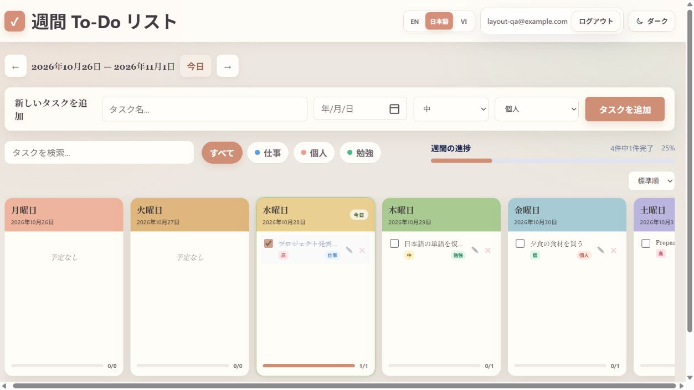
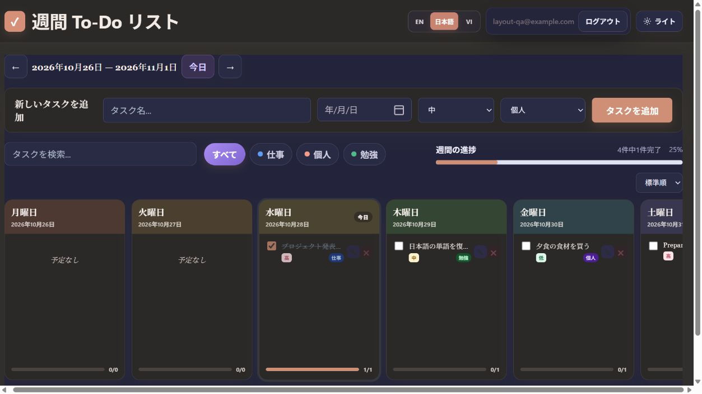

# Weekly To-Do List

1週間の予定を日ごとに整理できる、多言語対応のフルスタックTo-Doアプリケーションです。

ユーザーごとにアカウントを作成し、仕事・勉強・プライベートのタスクを安全に管理できます。デスクトップ、タブレット、スマートフォンに対応しています。

## デモ

[アプリを開く](https://todo-list.npma.workers.dev/)

## スクリーンショット

### ライトモード



### ダークモード



## 主な機能

- メールアドレスとパスワードによる新規登録・ログイン
- ユーザーごとのタスク保存
- タスクの追加、編集、削除
- タスクの完了・未完了の切り替え
- 日付、優先度、カテゴリーの設定
- `仕事`、`勉強`、`個人`カテゴリーによる絞り込み
- タスク名による検索
- 優先度または期限による並べ替え
- 前週・今週・次週への移動
- 週間進捗の表示
- 完了済みタスクの一括削除
- ライトモード・ダークモード
- 日本語・英語・ベトナム語の切り替え
- 選択した言語に合わせた日付表示
- PC、タブレット、スマートフォン対応のレスポンシブデザイン
- キーボード操作に対応した編集・削除モーダル

## 使用技術

### フロントエンド

- HTML5
- CSS3
- JavaScript

### バックエンド

- Cloudflare Workers
- Cloudflare D1（SQLite）
- Cookieベースのセッション認証

### デプロイ

- Cloudflare Workers Static Assets
- Wrangler

## システム構成

```text
ユーザー
   ↓
HTML / CSS / JavaScript
   ↓
Cloudflare Worker API
   ↓
Cloudflare D1 Database
```

## プロジェクト構成

```text
todo-list/
├── cloudflare/
│   ├── public/
│   │   ├── css/
│   │   │   ├── board.css
│   │   │   ├── pastel.css
│   │   │   └── style.css
│   │   ├── images/
│   │   ├── js/
│   │   │   └── app.js
│   │   └── index.html
│   ├── src/
│   │   └── worker.js
│   ├── migration-auth.sql
│   ├── schema.sql
│   ├── package.json
│   └── wrangler.jsonc
├── images/
├── .gitignore
└── README.md
```

## ローカル環境での実行方法

### 必要な環境

- Node.js
- npm
- Cloudflareアカウント

### セットアップ

```bash
git clone https://github.com/anhnguyen1280/todo-list.git
cd todo-list/cloudflare
npm install
```

ローカルのD1データベースを作成します。

```bash
npx wrangler d1 execute todo-list-db --local --file ./schema.sql
```

開発サーバーを起動します。

```bash
npx wrangler dev --local
```

ブラウザで `http://localhost:8787` を開きます。

## デプロイ

Cloudflareへデプロイするには、次のコマンドを実行します。

```bash
npx wrangler deploy
```

## 今後追加したい機能

- パスワード再設定
- Googleアカウントでのログイン
- 繰り返しタスク
- メール・ブラウザ通知
- タスクのドラッグ＆ドロップ
- 生産性レポート

## 作者

このプロジェクトは、フロントエンド、バックエンド、認証、データベース、クラウドデプロイを学ぶために作成しました。
